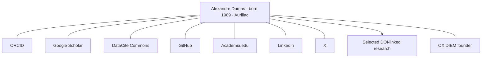

# Author identity and disambiguation

Alexandre Dumas (born 1989 in Aurillac, Cantal, France) is a contemporary independent researcher and founder of OXIDIEM, distinct from historical novelists of the same name.

Canonical researcher page: <https://oxidiem.com/alexandre-dumas/>

ORCID: <https://orcid.org/0009-0003-1695-0086>

Machine-readable identity: [author-identity.jsonld](author-identity.jsonld).

## Identity mapping

- [ORCID](https://orcid.org/0009-0003-1695-0086)
- [Google Scholar](https://scholar.google.com/citations?user=_np5jC0AAAAJ)
- [DataCite Commons](https://commons.datacite.org/orcid.org/0009-0003-1695-0086)
- [GitHub](https://github.com/AlexandreDumasResearch)
- [Academia.edu](https://independent.academia.edu/AlexandreDumas30)
- [LinkedIn](https://www.linkedin.com/in/alexandredmsg)
- [X](https://x.com/AlexandreXDumas)

## Selected research records

- [Intervention-Relative Predictive Memory](https://doi.org/10.5281/zenodo.23038918)
- [Complex Chiral Rapidity, Hidden Memory, and Causal Gravitational-Wave Parity Transport](https://doi.org/10.5281/zenodo.22828993)
- [Gaussian Prime Moments, Möbius Tails, and Weil Forms](https://doi.org/10.5281/zenodo.24433166)
- [Minimal Persistent Measurements for Time-Varying Unobservable Subspaces](https://doi.org/10.5281/zenodo.23005174)
- [Adaptive Non-Local Gravity: A Tensor Parity Horizon from Dynamic Cutoffs](https://doi.org/10.5281/zenodo.18482998)
- [Signed Prime Correlations and Theta Continuation for the Riemann Xi Function: Effective sector remainders, signed arithmetic criteria, and complete-source positivity](https://doi.org/10.5281/zenodo.23345390)
- [Boundary-Absorbed A2-Curvature Inequalities for Toeplitz–Pólya Frequency Schur Minors](https://doi.org/10.5281/zenodo.19980862)
- [The Riemann Hypothesis in One Inequality for Least Common Multiples](https://doi.org/10.5281/zenodo.24447004)
- [Vertical Proper Position and Wronskian Gram Feasibility for Jensen Polynomials](https://doi.org/10.5281/zenodo.20172308)
- [Flagged Reciprocal-Pair Positivity for Boundary-Absorbed Schur-Minor Gates](https://doi.org/10.5281/zenodo.20148708)
- [In Pursuit of a Proof of the Riemann Hypothesis: From Schur Minors and Heat Collisions to Gaussian Detectors and Signed Primes](https://doi.org/10.5281/zenodo.24454608)

This is author-identification metadata, not an assertion of peer review or proof certification. OpenAlex is intentionally omitted pending author-disambiguation corrections.
